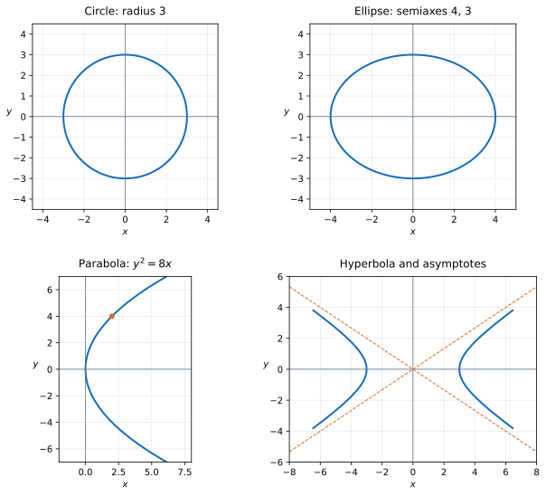

# Exercise 1. Recognizing Curves from Canonical Form

## Question

Recognize the curves

$$
x^2+y^2=9,
$$

$$
\frac{x^2}{16}+\frac{y^2}{9}=1,
$$

$$
y^2=8x,
$$

$$
\frac{x^2}{9}-\frac{y^2}{4}=1.
$$

For each one, identify the most important features and make a sketch. Explain which parts of the equation let you recognize the type of curve.

> **Why this exercise:** builds the basic dictionary: canonical equation → type of curve → shape and scale.

## Solution

**1. Circle:** $x^2+y^2=9$ has center $(0,0)$ and radius $3$. It meets the axes at $(\pm3,0)$ and $(0,\pm3)$. Equal squared coefficients indicate the same scale in both directions.

**2. Ellipse:** $x^2/16+y^2/9=1$ has center $(0,0)$, horizontal semiaxis $4$, and vertical semiaxis $3$. Its vertices on the axes are $(\pm4,0)$ and $(0,\pm3)$. Both squared terms are positive but have different denominators.

**3. Parabola:** $y^2=8x$ has vertex $(0,0)$, horizontal symmetry axis $y=0$, and opens toward positive $x$. In $y^2=4px$, $p=2$; thus the focus is $(2,0)$. One coordinate is squared and the other is linear.

**4. Hyperbola:** $x^2/9-y^2/4=1$ has center $(0,0)$, vertices $(\pm3,0)$, horizontal opening branches, and asymptotes

$$
y=\pm\frac23x.
$$

The opposite signs of the squared terms identify a hyperbola.

**Checks:** $(3,0)$ satisfies the circle; $(4,0)$ satisfies the ellipse; $(2,4)$ satisfies $y^2=8x$; and $(3,0)$ satisfies the hyperbola. These points confirm the scales and opening directions shown in the sketches.
