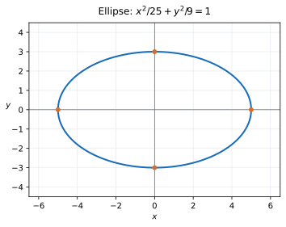

# Exercise 3. Ellipse

## Question

For

$$
\frac{x^2}{25}+\frac{y^2}{9}=1,
$$

find the semiaxis lengths, the intercepts with the coordinate axes, and make a sketch. Explain along which axis the ellipse is more stretched and how this is visible in the equation.

> **Why this exercise:** teaches how to read the size and orientation of an ellipse without additional conceptual machinery.

## Solution

For

$$
\frac{x^2}{25}+\frac{y^2}{9}=1,
$$

the semiaxis lengths are $a=\sqrt{25}=5$ along the $x$-axis and $b=\sqrt9=3$ along the $y$-axis. The center is $(0,0)$.

The axis intercepts are

$$
(\pm5,0),\qquad (0,\pm3).
$$

Since $25>9$, the ellipse is more stretched horizontally. The greater denominator permits a greater absolute coordinate in that direction.

**Check:** Substituting $(5,0)$ gives $25/25=1$; substituting $(0,3)$ gives $9/9=1$. By symmetry, the corresponding negative intercepts also satisfy the equation.
