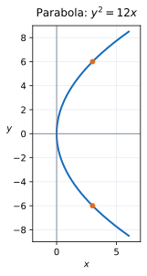

# Exercise 4. Parabola

The equation is

$$
y^2=12x.
$$

It has vertex $(0,0)$, axis of symmetry $y=0$ (the $x$-axis), and opens to the right because $x=y^2/12\ge0$.

At $x=3$,

$$
y^2=12(3)=36
\quad\Longrightarrow\quad y=\pm6.
$$

Thus $(3,6)$ and $(3,-6)$ are points on the curve, one above and one below the symmetry axis.

**Check:** Both points give $y^2=36=12\cdot3$. The equation is unchanged when $y$ is replaced by $-y$, verifying symmetry across the $x$-axis.
