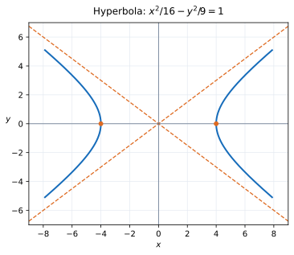

# Exercise 5. Hyperbola and Asymptotes

## Question

For

$$
\frac{x^2}{16}-\frac{y^2}{9}=1,
$$

find the intercepts with the $x$-axis, the asymptotes, and make a sketch. Explain why the asymptotes describe the behavior of the curve far from the center.

> **Why this exercise:** shows the role of asymptotes in understanding the global shape of a hyperbola.

## Solution

For

$$
\frac{x^2}{16}-\frac{y^2}{9}=1,
$$

the center is $(0,0)$ and the transverse axis is horizontal. Setting $y=0$ gives $x^2=16$, so the $x$-intercepts and vertices are $(4,0)$ and $(-4,0)$.

Here $a=4$ and $b=3$. The asymptotes are

$$
y=\pm\frac{b}{a}x=\pm\frac34x.
$$

The hyperbola has two separate branches opening left and right.

**Explanation:** Rearranging gives $y^2=(9/16)x^2-9$. For large $|x|$, the constant $-9$ becomes negligible compared with $x^2$, so the curve approaches $y\approx\pm(3/4)x$.

**Check:** $(\pm4,0)$ satisfy the equation. The asymptotes pass through the center and have slopes $\pm3/4$, consistent with the canonical form.
