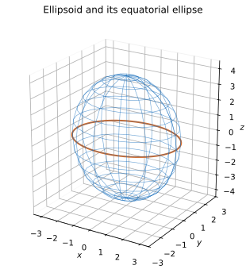

# Exercise 9. Ellipsoid and Its Cross-Sections

The surface is

$$
\frac{x^2}{9}+\frac{y^2}{4}+\frac{z^2}{16}=1.
$$

It is an ellipsoid centered at the origin with semiaxis lengths $3$ along $x$, $2$ along $y$, and $4$ along $z$ (the longest direction).

At $z=0$, its horizontal cross-section is the ellipse

$$
\frac{x^2}{9}+\frac{y^2}{4}=1.
$$

At a fixed $z=c$ with $|c|<4$,

$$
\frac{x^2}{9}+\frac{y^2}{4}=1-\frac{c^2}{16}.
$$

Its semiaxes are

$$
a_x=3\sqrt{1-\frac{c^2}{16}},\qquad
a_y=2\sqrt{1-\frac{c^2}{16}}.
$$

**Explanation and check:** The section is largest at $c=0$, shrinks symmetrically as $|c|$ increases, becomes the single point $(0,0,\pm4)$ at $|c|=4$, and has no real points when $|c|>4$. The factor under each square root confirms this behavior.
