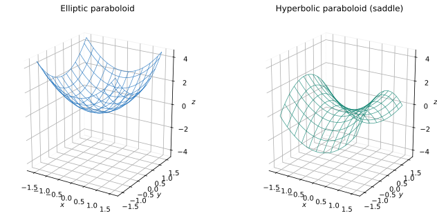

# Exercise 10. Paraboloids

## Question

Compare

$$
z=x^2+y^2
$$

and

$$
z=x^2-y^2.
$$

For each surface, describe the cross-sections $x=0$, $y=0$, and $z=c$, then make a qualitative sketch.

> **Why this exercise:** teaches how to distinguish two basic types of paraboloids from their cross-sections.

## Solution

**Surface 1: $z=x^2+y^2$.** The sections are:

- $x=0$: $z=y^2$, an upward-opening parabola in the $yz$-plane.
- $y=0$: $z=x^2$, an upward-opening parabola in the $xz$-plane.
- $z=c$: $x^2+y^2=c$. For $c>0$ this is a circle of radius $\sqrt c$; for $c=0$ it is the origin; for $c<0$ there are no real points.

This is an upward-opening **elliptic paraboloid**, shaped like a bowl.

**Surface 2: $z=x^2-y^2$.** The sections are:

- $x=0$: $z=-y^2$, a downward-opening parabola.
- $y=0$: $z=x^2$, an upward-opening parabola.
- $z=c$: $x^2-y^2=c$. For $c>0$ the hyperbola opens along $x$; for $c<0$ it opens along $y$; for $c=0$ it is the two crossing lines $y=\pm x$.

This is a **hyperbolic paraboloid**, shaped like a saddle.

**Check:** At the same distance $1$ from the origin, the first surface has $z(1,0)=z(0,1)=1$, while the second has $z(1,0)=1$ but $z(0,1)=-1$. This confirms the opposite curvature in its two principal directions.
