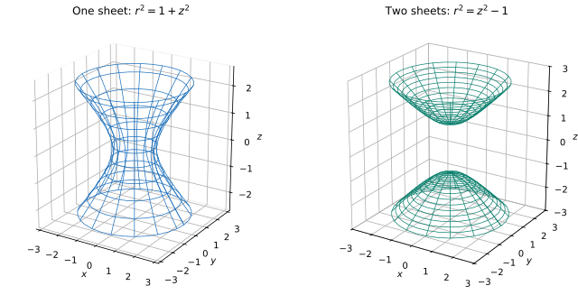

# Exercise 11. Two Similar Surfaces

**First surface:** $x^2+y^2-z^2=1$. At $z=c$,

$$
x^2+y^2=1+c^2.
$$

Every real $c$ gives a circle of radius $r(c)=\sqrt{1+c^2}$. For example, the radii at $c=0,\pm1,\pm2$ are $1,\sqrt2,\sqrt5$. The radius is smallest at $z=0$ but never vanishes. Thus the surface is a connected **hyperboloid of one sheet**.

**Second surface:** $x^2+y^2-z^2=-1$. At $z=c$,

$$
x^2+y^2=c^2-1.
$$

- $|c|<1$: no cross-section exists.
- $|c|=1$: the section is one point $(0,0,c)$.
- $|c|>1$: the section is a circle of radius $\sqrt{c^2-1}$; at $c=\pm2$, its radius is $\sqrt3$.

The disconnected upper and lower portions make this a **hyperboloid of two sheets**.

**Check:** At $z=0$ the first equation gives the circle $x^2+y^2=1$, while the second demands $x^2+y^2=-1$, which has no real points. This immediately distinguishes their shapes.
