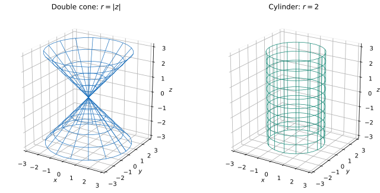

# Exercise 14. Cone and Cylinder

## Question

Compare

$$
x^2+y^2=z^2
$$

and

$$
x^2+y^2=4.
$$

For each surface, describe the cross-sections $z=c$, $x=0$, and $y=0$, make a sketch, and explain why the radius of the cross-section depends on $z$ in the first case but is constant in the second.

> **Why this exercise:** teaches how to distinguish a cone from a cylinder by the behavior of their cross-sections.

## Solution

**Surface 1: $x^2+y^2=z^2$.**

- At $z=c$: $x^2+y^2=c^2$, a circle of radius $|c|$ (one point when $c=0$).
- At $x=0$: $y^2=z^2$, giving the intersecting straight lines $z=\pm y$.
- At $y=0$: $x^2=z^2$, giving $z=\pm x$.

The horizontal radius increases linearly with $|z|$, producing an upper and lower cone with common vertex $(0,0,0)$.

**Surface 2: $x^2+y^2=4$.**

- At $z=c$: the circle $x^2+y^2=4$ of radius $2$, for every real $c$.
- At $x=0$: the vertical lines $y=\pm2$.
- At $y=0$: the vertical lines $x=\pm2$.

The radius is constant because $z$ does not appear in the equation. This is a circular cylinder of radius $2$ extending in both vertical directions.

**Check:** At heights $z=1$ and $z=3$, the cone has radii $1$ and $3$, whereas the cylinder has radius $2$ at both heights. This verifies the different cross-section behavior.
