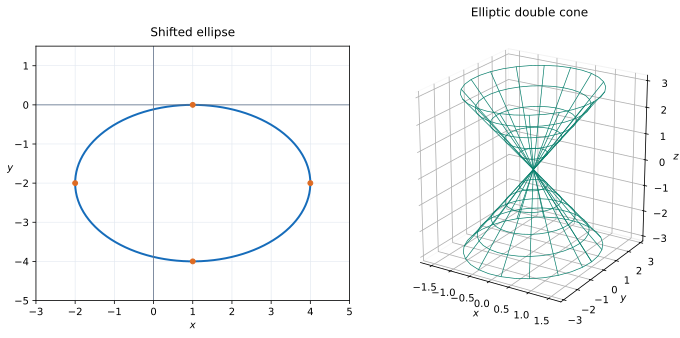

# Exercise 15. Recognition and Sketch Without a Given Name

## Question

Consider the two equations:

$$
4x^2+9y^2-8x+36y+4=0,
$$

$$
4x^2+y^2=z^2.
$$

For the first equation, reduce it to canonical form, recognize the curve, give its most important features, and make a sketch.

For the second equation, do not begin by using a ready-made name for the surface. First describe the cross-sections $z=c$ and the cross-sections by the planes $x=0$ and $y=0$, paying attention to the different scales along the axes. Only then identify the surface and make a sketch.

> **Why this exercise:** tests transfer of the two main mechanisms of the set—moving to canonical form and recognizing an object through cross-sections—without allowing the easiest example to be chosen.

## Solution

**First equation:**

$$
4x^2+9y^2-8x+36y+4=0.
$$

Complete both squares:

$$
\begin{aligned}
4(x^2-2x)+9(y^2+4y)+4&=0\\
4\bigl((x-1)^2-1\bigr)+9\bigl((y+2)^2-4\bigr)+4&=0\\
4(x-1)^2+9(y+2)^2&=36.
\end{aligned}
$$

Canonical form is

$$
\frac{(x-1)^2}{9}+\frac{(y+2)^2}{4}=1.
$$

This is an **ellipse** centered at $(1,-2)$, with horizontal semiaxis $3$ and vertical semiaxis $2$. Its four axis vertices are $(-2,-2)$, $(4,-2)$, $(1,0)$, and $(1,-4)$. Substituting $(4,-2)$ gives $9/9=1$, checking one extreme point.

**Second equation:** $4x^2+y^2=z^2$.

- At $z=c$, the section is $4x^2+y^2=c^2$. If $c\neq0$, it is an ellipse with semiaxis $|c|/2$ in the $x$ direction and $|c|$ in the $y$ direction. At $c=0$, the section is a single point.
- At $x=0$, the equation becomes $y^2=z^2$, giving $z=\pm y$.
- At $y=0$, it becomes $4x^2=z^2$, giving $z=\pm2x$.

The horizontal sections expand as $|z|$ increases in either vertical direction and are twice as wide along $y$ as along $x$. Therefore the surface is an **elliptic double cone**, with vertex at the origin.

**Check:** At $z=2$, the cone section is $x^2+y^2/4=1$, so $(\pm1,0,2)$ and $(0,\pm2,2)$ lie on it, confirming both axis scales.
