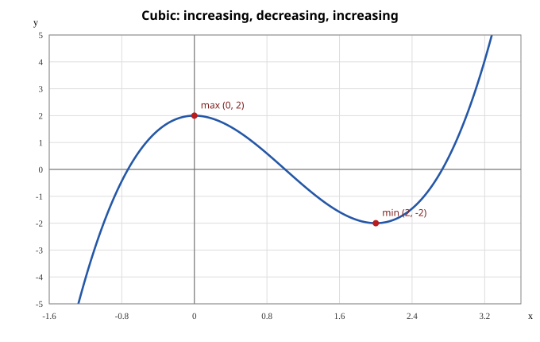

# Problem 1. A Cubic Polynomial

## Question

Analyze the monotonicity and extrema of

$$
f(x)=x^3-3x^2+2.
$$

Sketch the graph based on the results and mark the critical points.

> **Why this problem:** it teaches how to use the first derivative to describe the shape of a polynomial.

## Solution

The derivative is

$$
f'(x)=3x^2-6x=3x(x-2).
$$

The critical points occur at $x=0,2$. The derivative is positive on $(-\infty,0)$ and $(2,\infty)$, and negative on $(0,2)$. Thus the function increases, decreases, and increases on those respective intervals.

At $x=0$, the sign changes from positive to negative: the local maximum is $(0,2)$. At $x=2$, it changes from negative to positive: the local minimum is $(2,-2)$.

**Check:** The second derivative $f''(x)=6x-6$ is negative at zero and positive at two, confirming the classifications. The leading cubic term gives the limits $-\infty$ and $+\infty$ at the left and right ends.

The graph follows these intervals, with the two critical points marked.

