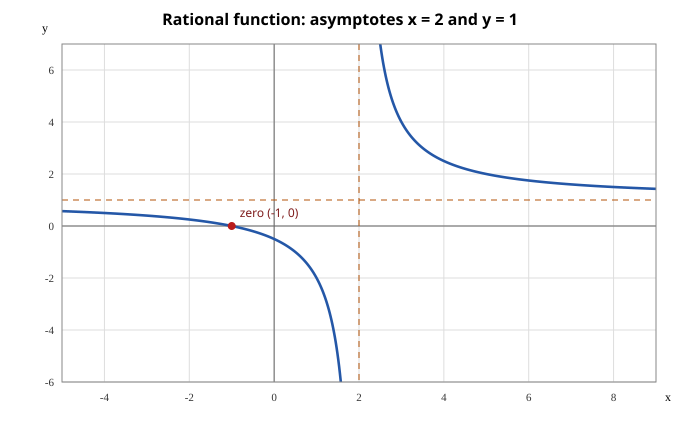

# Problem 3. A Rational Function

## Question

Analyze the domain, zeros, asymptotes, and monotonicity of

$$
f(x)=\frac{x+1}{x-2}.
$$

Finally, sketch a graph consistent with all the information obtained.

> **Why this problem:** it teaches how to combine the domain, limits, and derivative in the analysis of a rational function.

## Solution

The denominator excludes $x=2$, so the domain is $\mathbb R\setminus\{2\}$. The numerator vanishes at $x=-1$, giving the zero $(-1,0)$.

Rewrite by division:

$$
f(x)=1+\frac3{x-2}.
$$

The vertical asymptote is $x=2$, with left-hand limit $-\infty$ and right-hand limit $+\infty$. Both limits at infinity equal $1$, so the horizontal asymptote is $y=1$.

Differentiation gives

$$
f'(x)=-\frac3{(x-2)^2}<0
$$

throughout the domain. The graph decreases separately on $(-\infty,2)$ and $(2,\infty)$.

**Check:** The point $(0,-1/2)$ satisfies the original expression. The rewritten form also shows the left branch lies below $1$ and the right branch above $1$.

