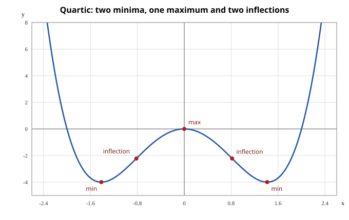

# Problem 8. The Second Derivative

## Question

For

$$
f(x)=x^4-4x^2
$$

find the local extrema, intervals of convexity and concavity, and inflection points. Sketch the graph and mark all the identified features on it.

> **Why this problem:** it introduces the second derivative as a tool for describing the curvature of a graph.

## Solution

The first and second derivatives are

$$
f'(x)=4x(x^2-2),\qquad f''(x)=12x^2-8.
$$

The first derivative vanishes at $-\sqrt2,0,\sqrt2$. Its sign on the four successive intervals is $-,+,-,+$. Thus the local minima are $(\pm\sqrt2,-4)$ and the local maximum is $(0,0)$.

The second derivative vanishes at $x=\pm\sqrt{2/3}$. It is positive for $|x|>\sqrt{2/3}$ (convex, concave up) and negative for $|x|<\sqrt{2/3}$ (concave down). Both zeros are genuine inflection points because the sign changes. Their coordinates are

$$
\left(\pm\sqrt{\frac23},-\frac{20}{9}\right).
$$

**Check:** At the stationary points, $f''(0)=-8$ and $f''(\pm\sqrt2)=16$, verifying the extrema. Also $f(x)=(x^2-2)^2-4\ge-4$, so the two minima are global. The graph is even and tends to $+\infty$ at both ends.

