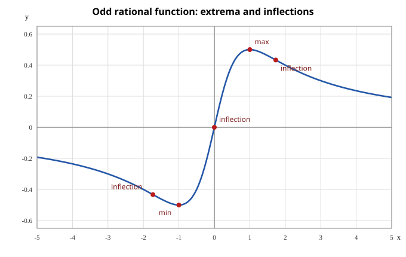

# Problem 10. Complete Function Analysis

## Question

Perform a complete analysis of

$$
f(x)=\frac{x}{x^2+1}.
$$

Include the domain, symmetry, zeros, limits, monotonicity, extrema, and convexity. Finally, produce a sketch based only on this information.

> **Why this problem:** it combines all the basic elements of function analysis into one organized process.

## Solution

**Domain, symmetry and zeros.** Since $x^2+1>0$, the domain is $\mathbb R$. The identity $f(-x)=-f(x)$ gives odd symmetry, and the only zero is $(0,0)$. The sign is the sign of $x$.

**Limits and asymptotes.** Dividing numerator and denominator by $x^2$ shows $\lim_{x\to\pm\infty}f(x)=0$. Thus $y=0$ is a horizontal asymptote, with no vertical asymptotes.

**Monotonicity and extrema.** The quotient rule gives

$$
f'(x)=\frac{1-x^2}{(x^2+1)^2}.
$$

It is negative for $|x|>1$ and positive for $|x|<1$. The function decreases on $(-\infty,-1)$ and $(1,\infty)$, and increases on $(-1,1)$. The global minimum is $(-1,-1/2)$, and the global maximum is $(1,1/2)$.

**Curvature.** Differentiating the first derivative gives

$$
f''(x)=\frac{2x(x^2-3)}{(x^2+1)^3}.
$$

It is positive on $(-\sqrt3,0)$ and $(\sqrt3,\infty)$, and negative on $(-\infty,-\sqrt3)$ and $(0,\sqrt3)$. The former intervals are convex (concave up), the latter concave down. The sign changes at all three inflection points:

$$
(-\sqrt3,-\sqrt3/4),\quad (0,0),\quad (\sqrt3,\sqrt3/4).
$$

**Check:** $x^2+1\ge2|x|$ implies $|f(x)|\le1/2$, confirming the global extrema. The sketch follows the symmetry, signs, extrema, curvature and horizontal asymptote derived above.

