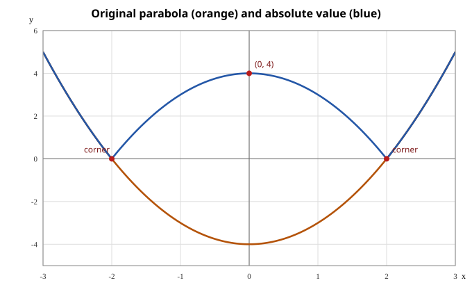

# Problem 12. A Function with an Absolute Value

## Question

Analyze

$$
f(x)=|x^2-4|.
$$

First sketch $x^2-4$, then explain the effect of the absolute value. Indicate the points where the derivative does not exist and justify the reason geometrically.

> **Why this problem:** it shows the limits of mechanical application of calculus and the importance of the geometry of the graph.

## Solution

First consider $g(x)=x^2-4$. It is an upward-opening parabola with vertex $(0,-4)$ and zeros $x=\pm2$.

Taking the absolute value keeps the parts of $g$ above the horizontal axis unchanged and reflects its negative portion upward. Thus

$$
f(x)=
\begin{cases}
x^2-4,& |x|\ge2, \\
4-x^2,& |x|<2. \\
\end{cases}
$$

The domain is $\mathbb R$. The global minima are $(\pm2,0)$, and there is a local maximum at $(0,4)$. The graph decreases on $(-\infty,-2)$ and $(0,2)$ and increases on $(-2,0)$ and $(2,\infty)$.

Away from the junctions, the derivative is $2x$ outside $[-2,2]$ and $-2x$ inside. At $-2$, the left slope is $-4$ and the right slope $4$. At $2$, the left slope is $-4$ and the right slope $4$. Thus the derivative does not exist at either $x=-2$ or $x=2$.

**Check:** The pieces meet continuously at value zero, but their slopes disagree; geometrically, the reflected graph has sharp corners there.
