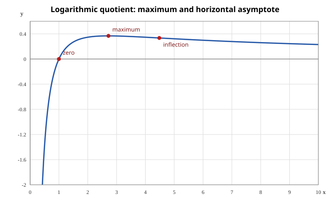

# Problem 13. A Logarithm and an Asymptote

## Question

Perform a complete analysis of

$$
f(x)=\frac{\ln x}{x},\qquad x>0.
$$

Find the maximum and the behavior at the ends of the domain. Explain which information is necessary for a correct sketch.

> **Why this problem:** it combines the domain, limits, and derivative in a less obvious example.

## Solution

**Domain and sign.** The domain is $(0,\infty)$. The only zero is $x=1$, with negative values on $(0,1)$ and positive values for $x>1$. There is no even or odd symmetry.

**Limits.** At the left end $\ln x/x\to-\infty$ as $x\to0^+$, giving the vertical asymptote $x=0$. At the right end, l'Hôpital's rule gives

$$
\lim_{x\to\infty}\frac{\ln x}{x}
=\lim_{x\to\infty}\frac1x=0.
$$

The horizontal asymptote is $y=0$, approached from above.

**Monotonicity.** The quotient rule gives

$$
f'(x)=\frac{1-\ln x}{x^2}.
$$

It is positive for $0<x<e$, zero at $e$, and negative for $x>e$. Thus the unique global maximum is $(e,1/e)$.

**Curvature.**

$$
f''(x)=\frac{2\ln x-3}{x^3}.
$$

The function is concave down on $(0,e^{3/2})$ and convex on $(e^{3/2},\infty)$, with inflection point $(e^{3/2},3/(2e^{3/2}))$.

**Check:** $f''(e)=-1/e^3<0$ confirms the maximum. A correct sketch must include the domain boundary, both asymptotes, the zero, monotonic intervals, maximum and curvature.

