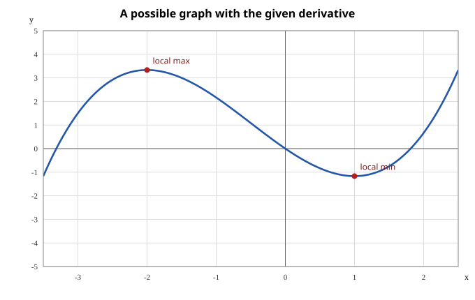

# Problem 14. Reconstructing Information from the Derivative

## Question

It is known that

$$
f'(x)=(x-1)(x+2).
$$

Determine the monotonicity and the locations of the extrema, and sketch a possible qualitative shape of the function. Then, for

$$
g(x)=\frac{x^3}{3}+\frac{x^2}{2}-2x
$$

verify that $g'(x)=(x-1)(x+2)$, and compare the specific graph with the earlier qualitative sketch.

> **Why this problem:** it teaches how to read the behavior of a function directly from its derivative.

## Solution

The derivative has zeros at $-2$ and $1$. The two linear factors have the same sign outside the roots and opposite signs between them.

| Interval | Sign of $f'$ | Behavior |
|---|---|---|
| $(-\infty,-2)$ | $+$ | Increasing |
| $(-2,1)$ | $-$ | Decreasing |
| $(1,\infty)$ | $+$ | Increasing |

Therefore there is a local maximum at $x=-2$ and a local minimum at $x=1$. Their vertical positions cannot be determined from the derivative alone because adding a constant leaves the derivative unchanged.

For the proposed function,

$$
g'(x)=x^2+x-2=(x-1)(x+2),
$$

exactly as required. Its extrema are $(-2,10/3)$ and $(1,-7/6)$. The particular cubic is a valid example of the qualitative shape; all differentiable functions on $\mathbb R$ with this derivative differ from it only by an additive constant.

**Check:** $g''(-2)=-3<0$ and $g''(1)=3>0$. The sketch marks the corresponding maximum and minimum.

