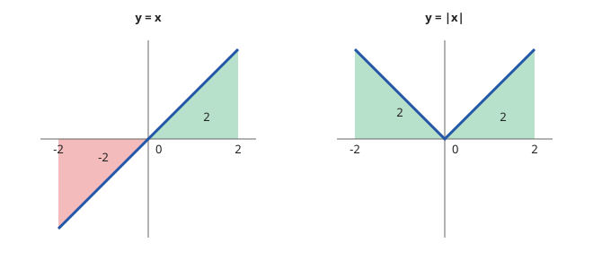

# Problem 12. Symmetry, Sign, and Absolute Value

## Question

Compare

$$
\int_{-2}^{2}x\,dx
$$

and

$$
\int_{-2}^{2}|x|\,dx.
$$

Before calculating, predict the results from symmetry and a sketch, then carry out the calculation and explain the difference.

> **Why this problem:** it teaches how to use symmetry and geometry before applying a computational procedure.

## Solution

**Prediction:** The graph of $y=x$ is odd; its two triangular signed areas cancel. The graph of $y=|x|$ is even and nonnegative, so its two equal triangular areas add. Each triangle has base and height $2$, giving area $2$.

**Calculation:**

$$
\int_{-2}^2x\,dx=\left[\frac{x^2}{2}\right]_{-2}^2=2-2=0.
$$

Since $|x|=-x$ for negative $x$ and $|x|=x$ for nonnegative $x$,

$$
\int_{-2}^2|x|\,dx
=-\int_{-2}^0x\,dx+\int_0^2x\,dx=2+2=4.
$$

**Check:** Both values agree with the initial symmetry prediction. The first integral measures signed accumulation, whereas the second measures the entire nonnegative geometric area.
