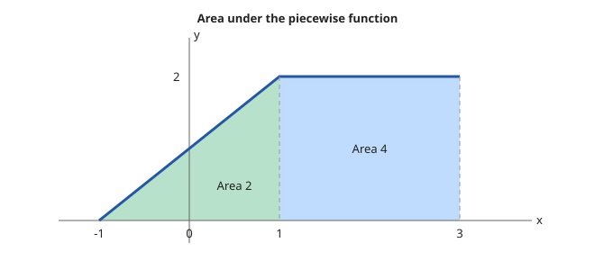

# Problem 14. A Piecewise-Defined Function

## Question

Let

$$
f(x)=
\begin{cases}
x+1,&-1\le x<1, \\
2,&1\le x\le3. \\
\end{cases}
$$

Sketch the graph, decide where to split the integral, compute

$$
\int_{-1}^{3}f(x)\,dx
$$

and verify the result geometrically.

> **Why this problem:** it requires understanding the definition of the function before carrying out the calculation.

## Solution

The first piece is the line from $(-1,0)$ to $(1,2)$; the second piece is the horizontal segment from $(1,2)$ to $(3,2)$. The pieces meet at height $2$, and the graph is nonnegative.

The formula changes at $x=1$, so split the integral there:

$$
\int_{-1}^3f(x)\,dx
=\int_{-1}^1(x+1)\,dx+\int_1^3 2\,dx.
$$

$$
=\left[\frac{x^2}{2}+x\right]_{-1}^1+2(3-1)=2+4=6.
$$

**Geometric check:** The first region is a triangle with base $2$ and height $2$, giving area $2$. The second is a rectangle of width $2$ and height $2$, giving area $4$. The total area is $6$, equal to the integral because the function is nonnegative.
