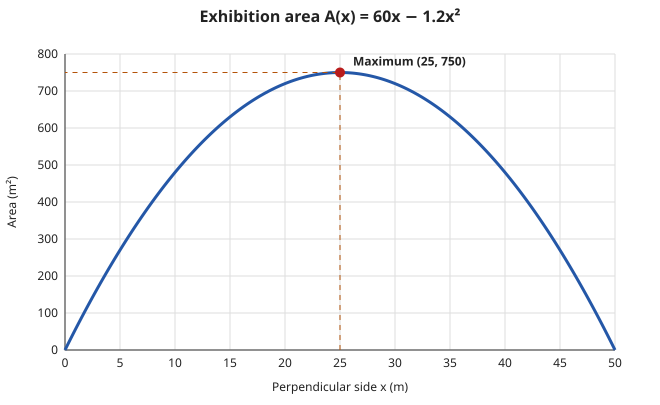

# Problem 12. Complete Model and Computer Verification

## Question

A museum wants to create a rectangular exhibition room next to an existing straight wall. The side along the wall does not need to be built. The remaining three sides are to be constructed to two different standards: the two sides perpendicular to the wall cost $300\ \mathrm{PLN/m}$ each, while the side parallel to the wall costs $500\ \mathrm{PLN/m}$. The budget is $30\,000\ \mathrm{PLN}$.

Build a model that maximizes the area of the room and prepare a complete analysis containing:

- definition of variables and units,
- mathematical model,
- domain resulting from the problem statement,
- computation of the derivative,
- determination and verification of the optimum,
- interpretation of the result,
- graph of the objective function,
- numerical verification of several values near the optimum found.

Finally, indicate which part of the solution required modeling the problem and which part was only the execution of the calculation. Produce the graph and computer calculations only after completing the mathematical solution, and treat them as verification.

> **Why this problem:** it checks full transfer to a new problem with unequal side costs and integrates the process from model construction to independent verification.

## Solution

**Model and variables.** Let $x$ denote each perpendicular side length and $y$ the side parallel to the existing wall, both measured in meters. The two perpendicular sides each cost $300$ PLN per meter, and the remaining parallel side costs $500$ PLN per meter. The model is

$$
600x+500y\le30000,\qquad x>0,\quad y>0.
$$

The area is $A=xy$ in square meters. For fixed positive $x$, area increases with $y$, so the optimum must use the entire budget. The equality gives

$$
y=60-\frac65x,\qquad 0<x<50.
$$

Thus the objective function is

$$
A(x)=60x-\frac65x^2.
$$

The endpoints of the closed extension $[0,50]$ both correspond to degenerate rooms with zero area.

**Mathematical optimization.** The first and second derivatives are

$$
A'(x)=60-\frac{12}{5}x,\qquad A''(x)=-\frac{12}{5}.
$$

The derivative is positive for $x<25$, zero at $25$, and negative for $x>25$. Strict concavity and this sign change prove the unique global maximum occurs at $x=25$ m. The remaining side is $y=60-(6/5)25=30$ m.

$$
A_{\max}=25\cdot30=750.
$$

The museum should construct two perpendicular walls of $25$ m and a parallel wall of $30$ m, yielding $750$ square meters.

**Mathematical verification:** The cost is $600(25)+500(30)=30000$ PLN. Completing the square gives $A(x)=750-(6/5)(x-25)^2\le750$.

**Computer verification after the mathematical solution.** The graph and table below evaluate the derived objective function only after the analytical optimum was obtained.

| Perpendicular side x (m) | Parallel side y (m) | Area (square m) |
|---:|---:|---:|
| 20 | 36 | 720 |
| 24 | 31.2 | 748.8 |
| 24.5 | 30.6 | 749.7 |
| 25 | 30 | 750 |
| 25.5 | 29.4 | 749.7 |
| 26 | 28.8 | 748.8 |
| 30 | 24 | 720 |

The numerical values on both sides are below $750$ and symmetric about $x=25$, confirming the mathematical solution.

**Modeling versus calculation:** Selecting the variables, recognizing the three paid walls, translating the costs into a budget constraint, establishing the feasible domain, and proving that the budget is exhausted are modeling steps. Differentiating the quadratic and solving its stationary-point equation are calculation steps. The graph and numerical values are verification, not a substitute for the mathematical argument.
